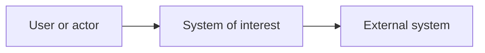

# High-Level Design (HLD)

> **Purpose:** Communicate the solution's structure and important architectural decisions to business, engineering, security, and operations stakeholders. Explain system boundaries, major building blocks, relationships, and how key quality requirements shape the design. Keep component internals and implementation contracts in the LLD.
>
> **How to use:** Replace bracketed prompts and link detailed artifacts rather than duplicating them. Tailor diagrams to their audience; use a C4 context/container view where useful. Record important decisions and trade-offs, not just a list of technologies.

## Document Control

| Field | Value |
|---|---|
| System / initiative | [Name and tracking link] |
| Business owner / product owner | [Name / role] |
| Architecture owner | [Name / role] |
| Authors / contributors | [Names / roles] |
| Version / status | [Version] / [Draft, In Review, Approved, Superseded] |
| Created / last updated | [YYYY-MM-DD] / [YYYY-MM-DD] |
| Classification | [Organizational label] |
| Related BRD / design / ADRs | [Links and IDs] |

### Review and Approval

| Reviewer | Perspective / role | Decision / conditions | Date |
|---|---|---|---|
| [Name] | [Business / architecture / security / operations / data] | [Pending / Approved / Rejected] | [YYYY-MM-DD] |

## 1. Executive Summary and Design Status

[Summarize the problem, proposed solution, important boundaries, major trade-offs, and decisions or approvals needed. State unresolved high-impact items.]

## 2. Goals, Scope, and Requirements

- **Business outcomes:** [Link to BRD outcome IDs.]
- **In scope:** [Capabilities, workloads, interfaces, and environments.]
- **Out of scope:** [Explicit exclusions.]
- **Users and stakeholders:** [Primary users, owners, operators, and external parties.]
- **Requirements baseline:** [Approved BRD / requirement IDs and version.]

## 3. Drivers, Principles, Constraints, and Assumptions

| ID | Driver / principle / constraint / assumption | Architectural impact | Owner / validation |
|---|---|---|---|
| DA-001 | [Requirement, principle, mandated constraint, or unverified assumption] | [Impact on design / consequence] | [Owner / date] |

## 4. System Context and Boundaries

Show the system in its environment: people and external systems, ownership, trust boundaries, and principal interactions. Keep diagrams focused on the question they answer.

[Replace this example with the actual context diagram. Label system boundaries and external interfaces.]

## 5. Architecture Overview

### 5.1 Logical Structure

[Insert a C4 container or equivalent logical view. Show major deployable applications, data stores, and communication relationships; link deeper component diagrams if needed.]

### 5.2 Building Blocks and Responsibilities

| ID | Building block | Responsibility | Ownership / trust boundary | Key dependencies |
|---|---|---|---|---|
| BB-01 | [Name] | [Single clear responsibility] | [Owner / boundary] | [Other blocks / systems] |

### 5.3 Principal Interactions and Data Flows

| Flow ID | Initiator and purpose | Protocol / direction | Data classification | Failure behavior / owner |
|---|---|---|---|---|
| FLOW-01 | [Actor and business purpose] | [Protocol / direction] | [Classification] | [Timeout, retry, fallback, alert owner] |

## 6. Deployment, Environments, and Network

[Show major deployment units and environments, regions / zones, connectivity, network and trust boundaries, and managed vs. customer responsibilities. Link detailed deployment diagrams or infrastructure definitions.]

| Environment | Purpose | Data / access restrictions | Promotion / configuration approach |
|---|---|---|---|
| [Name] | [Purpose] | [Restrictions] | [Approach] |

## 7. Data Architecture and Integrations

- **Data domains and ownership:** [Source of truth, system of record, stewardship.]
- **Classification and sensitivity:** [Classification, regulated / personal data, residency constraints.]
- **Lifecycle:** [Collection, purpose, storage, retention, archival, deletion.]
- **Integration contracts:** [Systems, interface owners, protocol, versioning, availability dependency.]
- **Data consistency and movement:** [Consistency model, replication, asynchronous flows.]

| Data set / interface | Owner / source | Classification | Lifecycle / contract |
|---|---|---|---|
| [Name] | [Owner] | [Class] | [Retention / interface link] |

## 8. Quality Attributes and Non-Functional Requirements

Prioritize the few attributes that materially drive architecture. Define measurable usage or change scenarios; do not treat labels such as "scalable" as acceptance criteria.

| ID | Priority / quality | Context and stimulus | Required response / target | Design response | Verification |
|---|---|---|---|---|---|
| QA-001 | [Priority / reliability, security, performance, etc.] | [Load, failure, actor, environment] | [Measurable threshold / SLO] | [Architectural mechanism] | [Test / telemetry / owner] |

## 9. Security, Privacy, and Compliance

- **Identity and access:** [Identity providers, authorization boundaries, privileged access.]
- **Threat model:** [Threat model link, trust boundaries, principal risks and mitigations.]
- **Data protection:** [Classification, encryption, key ownership, secret management, retention.]
- **Secure delivery:** [Supply chain, vulnerability management, deployment controls.]
- **Audit and compliance:** [Applicable policies / regulations, evidence, control owners.]
- **Security decisions / exceptions:** [Decision, approver, expiry, and tracking link.]

## 10. Reliability, Continuity, and Recovery

| Critical capability | Availability target / SLO | RTO | RPO | Failure domains / recovery approach | Evidence / owner |
|---|---|---|---|---|---|
| [Capability] | [Target and measurement window] | [Time] | [Time] | [Strategy] | [Exercise / owner] |

[Describe dependencies, graceful degradation, backup and restore responsibilities, continuity assumptions, and recovery-test cadence.]

## 11. Operations and Observability

- **Service ownership and support:** [Owning team, support coverage, escalation path.]
- **Golden signals / SLOs:** [Availability, latency, traffic, errors, saturation; link dashboards.]
- **Logs, metrics, traces, and audit:** [Coverage, correlation, access, redaction, and retention.]
- **Alerting:** [Actionable conditions, routing, severity, and responder.]
- **Operational procedures:** [Incident, deployment, rollback, recovery runbook links.]
- **Operational readiness:** [Readiness review, service acceptance, known limitations.]

## 12. Architecture Decisions and Alternatives

List material decisions here and link a separate ADR for each decision that warrants its own rationale and lifecycle.

| ID / ADR | Decision and status | Chosen option | Alternatives | Rationale, consequences, and trade-offs |
|---|---|---|---|---|
| ADR-001 | [Topic / proposed, accepted, superseded] | [Choice] | [Options considered] | [Benefits, costs, risks, and constraints] |

## 13. Cost, Risks, and Technical Debt

| ID | Cost driver / risk / debt | Impact and likelihood | Mitigation / estimate basis | Owner / due date |
|---|---|---|---|---|
| RISK-001 | [Description] | [Impact / likelihood] | [Response / assumptions] | [Owner / date] |

## 14. Migration, Delivery, and Architecture Validation

- **Transition / migration:** [Phases, coexistence, data migration, cutover, rollback.]
- **Deployment strategy:** [Release model, progressive delivery, environment promotion.]
- **Architecture acceptance criteria:** [Requirements, quality scenarios, control evidence, and owners.]
- **Validation plan:** [Prototype, threat review, performance / failure tests, production-readiness review.]

## 15. Open Questions and Follow-Up

| ID | Question / action | Decision owner | Due date | Status / impact if unresolved |
|---|---|---|---|---|
| OPEN-001 | [Question or action] | [Role] | [Date] | [Status / impact] |

## 16. References and Change History

- [BRD, LLD, ADRs, data / sequence / deployment diagrams, threat model, service objectives.]

| Version | Date | Author | Change | Review / approval reference |
|---|---|---|---|---|
| 0.1 | [YYYY-MM-DD] | [Name] | Initial draft | [Link / pending] |

### Guidance

- [arc42: Architecture documentation overview](https://arc42.org/overview)
- [C4 model: Diagram types and levels of detail](https://c4model.com/diagrams)
- [Microsoft Azure Well-Architected Framework](https://learn.microsoft.com/en-us/azure/well-architected/)
