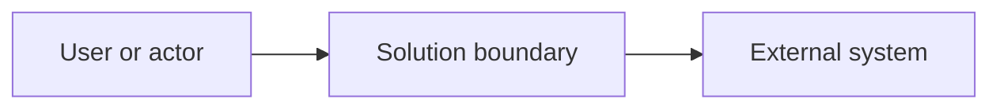

# High-Level Design (HLD)

> Describe the solution at the level needed to align business, engineering, security, and operations stakeholders. Keep implementation details in the LLD. Mark non-applicable sections as **N/A** and link supporting artifacts.

## Document Control

| Field | Value |
|---|---|
| Project / solution | [Name] |
| Document owner | [Name / role] |
| Version / status | [Version] / [Draft, In Review, Approved] |
| Created / last updated | [Date] / [Date] |
| Reviewers / approvers | [Names and roles] |

## 1. Executive Summary

[Summarize the proposed solution, the need it addresses, and its most important architectural characteristics.]

## 2. Goals, Scope, and Context

- **Goals:** [Desired outcomes]
- **In scope:** [Capabilities and systems covered]
- **Out of scope:** [Explicit exclusions]
- **Users and stakeholders:** [Primary users, owners, and external parties]
- **Related requirements:** [BRD / requirement IDs and links]

## 3. Architecture Principles and Key Drivers

| Driver / principle | Design implication |
|---|---|
| [Business or technical driver] | [How it shapes the design] |

## 4. System Context

[Insert a context diagram showing users, the solution boundary, and external systems. Use a Mermaid diagram, image, or link.]

## 5. Proposed Architecture

### Logical Architecture

[Insert a component / container diagram and explain the main boundaries.]

### Components and Responsibilities

| Component | Responsibility | Owner / boundary | Key dependencies |
|---|---|---|---|
| [Component] | [Purpose] | [Team / trust boundary] | [Dependencies] |

### Key Interactions and Data Flows

| Flow | Initiator | Main steps | Data exchanged | Failure considerations |
|---|---|---|---|---|
| [Flow] | [Actor / component] | [Summary] | [Data classification] | [Timeout / retry / fallback] |

## 6. Deployment and Environment View

[Show environments, major deployment units, network or trust boundaries, and external connectivity. Link the detailed deployment view if separate.]

## 7. Data and Integration Overview

- **Data domains and ownership:** [Summary]
- **Classification / residency / retention:** [Summary]
- **Integrations and protocols:** [Systems, direction, and protocol]
- **Data lifecycle:** [Creation, use, archival, and deletion]

## 8. Quality Attributes and Non-Functional Requirements

| Attribute | Requirement / target | Architectural approach | Verification |
|---|---|---|---|
| Availability | [SLO / target] | [Approach] | [Test / measurement] |
| Performance | [Latency / throughput target] | [Approach] | [Test / measurement] |
| Scalability | [Load / growth target] | [Approach] | [Test / measurement] |
| Recoverability | [RTO / RPO] | [Approach] | [Exercise / test] |
| Accessibility / usability | [Applicable target] | [Approach] | [Verification] |

## 9. Security, Privacy, and Compliance

- **Identity and access:** [Authentication, authorization, privileged access]
- **Trust boundaries and threat considerations:** [Key threats and mitigations]
- **Data protection:** [Encryption, secrets, classification, retention]
- **Audit and compliance:** [Required controls, evidence, and policies]
- **Security review / open actions:** [Links and owners]

## 10. Resilience and Disaster Recovery

[Summarize failure domains, redundancy, backup / restore approach, recovery objectives, and dependencies.]

## 11. Operations and Observability

- **Monitoring and alerting:** [Key signals, alert ownership, and escalation]
- **Logging / tracing:** [Coverage, access, retention, sensitive-data handling]
- **Support model:** [Service owner, support hours, handoffs]
- **Runbooks:** [Links to operational procedures]

## 12. Decisions, Alternatives, and Trade-Offs

| Decision | Chosen approach | Alternatives considered | Rationale / trade-off | ADR |
|---|---|---|---|---|
| [Topic] | [Choice] | [Options] | [Reasoning] | [Link] |

## 13. Cost, Risks, and Open Questions

- **Cost drivers / estimate:** [Major cost factors and assumptions]
- **Risks and mitigations:** [Risk, impact, owner, action]
- **Open questions:** [Question, decision owner, due date]

## 14. Delivery and Acceptance

[Summarize rollout / migration approach, key milestones, and architecture acceptance criteria.]

## 15. References and Change History

- [BRD, LLD, ADRs, diagrams, threat model, standards]

| Version | Date | Author | Summary of change |
|---|---|---|---|
| 0.1 | [Date] | [Name] | Initial draft |
